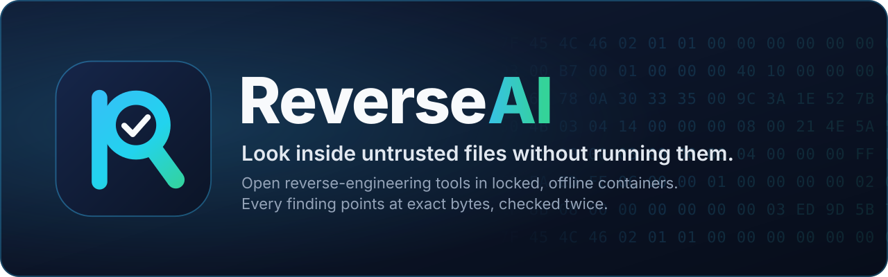

<p align="center">
  
</p>

https://github.com/user-attachments/assets/884cff5d-e37e-49c3-9bb7-8fbcf118e2ee

<p align="center">
  
  
  
  
  
  <br>
  
  
  
  
  
</p>

<p align="center">
  <a href="#why-reverseai">Why</a> ·
  <a href="#what-it-analyses">What it analyses</a> ·
  <a href="#how-it-works">How it works</a> ·
  <a href="#the-tools">The tools</a> ·
  <a href="#the-secure-container-infrastructure">Secure containers</a> ·
  <a href="#ai-analyst-team-the-hive">AI analyst team</a> ·
  <a href="#quick-start">Quick start</a> ·
  <a href="#roadmap">Roadmap</a>
</p>

**ReverseAI is an open-source engine for static reverse engineering of untrusted
files.** It opens programs, Android apps and JavaScript packages *without running
them*, puts the heavy analysis tools inside locked, offline containers, and reports as
verified only what it can prove from the file's own bytes. Every answer says where in
the file it comes from, which tool produced it and whether ReverseAI verified it
or it is a tool's interpretation.

It works from the command line and from AI agents: its MCP server lets Claude Code,
Codex, Cursor or any other Model Context Protocol client investigate a file, while
every answer it receives stays checkable and the file never leaves its locked setup.
On top of it, an optional **AI analyst team** (the *hive*) splits a native program
among parallel agents, has an independent council challenge every part, and rebuilds
the program as C or C++ that compiles and is checked against the original.

## Why ReverseAI

Looking inside a suspicious file usually means trusting a large toolchain with
it, and then trusting whatever the tool, or an AI model, says about it.
ReverseAI removes both kinds of blind trust:

- **The file is never executed.** It is copied once into a frozen, fingerprinted
  snapshot and read as data. No sample code, install script or package manager
  ever runs.
- **Heavy tools are locked away.** Decompilers and parsers run in a fresh
  container per question, with no network, a read-only system, no privileges and
  hard limits. Nothing of your home folder or workspace is visible to them.
- **Nothing is taken on faith.** ReverseAI recomputes every byte-level fact a
  tool reports, such as headers, offsets, matches and code anchors, from the
  original bytes. A single mismatch rejects the tool's whole answer, so a
  compromised or buggy tool can hide evidence but cannot invent verified evidence.
- **Facts and interpretations stay apart.** Decompiled code and call graphs are
  useful but are a tool's reading; they are always labelled as such and can never
  overrule a verified fact.
- **Open and reproducible.** MIT-licensed, built on official open-source tools
  pinned by hash, with no Python dependencies. The same file and settings give the
  same report.

## What it analyses

| You give it | You get |
| --- | --- |
| **Native programs**: Linux (ELF), Windows (PE) and macOS (Mach-O) executables and libraries | File structure, segments and sections, entry point, imported libraries and functions, symbols, strings and raw byte ranges. With Ghidra: the list of functions, decompiled pseudocode, assembly, who calls what, and cross-references. |
| **Android apps**: APK packages and the DEX bytecode inside them | Package contents, the binary manifest's declarations such as the package name and permissions, classes, methods and the references between them. With JADX: the decompiled Java of a chosen method. |
| **JavaScript applications**: ZIP archives, Electron ASAR archives, npm packages (`.tgz`) and single bundles | The file inventory, `package.json` declarations (including install scripts, read but never run) and hints such as process spawning, dynamic code or credential access. With the Babel parser: where modules are imported and where sensitive functions are called. |

You can ask for a **full report** on a file (`analyze`) or ask **one precise
question** (`query`): list the functions, decompile one, show who calls it, search
the strings, read bytes at an address, inspect an Android class or method, or page
through a JavaScript application. The full list of questions is in the
[usage guide](docs/USAGE.md).

Every report comes as JSON and Markdown and sorts findings into four groups:

| Label | Meaning |
| --- | --- |
| **Supported** | ReverseAI verified the value from the cited bytes with a fixed rule for that kind of claim. |
| **Derived** | A tool's interpretation, such as decompiled code or a call relationship, anchored to bytes ReverseAI verified, but still the tool's reading. |
| **Unsupported** | A claim whose evidence did not check out, shown with the reviewer's reason. |
| **Contradicted** | Verified facts that disagree with each other. |

Supported means the bytes say exactly this; it never means the file is safe,
malicious or behaves in a certain way.

## How it works

<p align="center">
  
</p>

1. **Freeze the file.** You approve one regular file. ReverseAI copies it into a
   private snapshot and fingerprints it with SHA-256; everything afterwards refers
   to that fingerprint. Links, hard-linked files and files that change while being
   read are refused.
2. **Go through the gateway.** A gateway accepts only a fixed list of operations,
   each with its own time and output budget. Nothing else can be asked of a tool.
3. **Read simple formats directly.** ReverseAI's own parsers, written with the
   Python standard library alone, decode executable headers, imports, strings,
   APK archives, the Android manifest, DEX bytecode, gzip and tar streams, ASAR
   archives and JSON. Their results are the verified reference.
4. **Run heavy tools in a locked container.** Ghidra, JADX, LIEF, YARA-X and the
   JavaScript parser run one fresh container per request, as described
   [below](#the-secure-container-infrastructure).
5. **Check the tool's answer.** The host recomputes every byte-level fact the
   tool reports from the original bytes and rejects the whole reply on any
   mismatch. A decompiled function or Java method is accepted only if it is
   anchored to code that ReverseAI located and verified itself; its text and
   relationships remain the tool's interpretation.
6. **Record evidence.** Each item of evidence binds the file fingerprint, the tool
   and its version, the operation, and the exact byte range with its own hash. For
   a file inside an archive it also records which member it came from and how that
   member was rebuilt from the original bytes.
7. **Write findings.** Analysts turn evidence into findings, and every finding
   must cite its evidence.
8. **Review independently.** A reviewer re-reads the cited bytes, rebuilds
   compressed members from the original archive and applies a fixed rule for each
   kind of claim. What it cannot confirm is not reported as supported.
9. **Report.** JSON and Markdown reports name each tool version and container
   image, and are written with private permissions into a new or empty folder.

## The tools

ReverseAI uses official releases of established open-source tools. Each one was
downloaded once, verified against its published hash and built into a local
image; at analysis time nothing is downloaded, pulled or installed.

| Tool | What it does in ReverseAI | How its answer is checked |
| --- | --- | --- |
| **Built-in parsers** (Python standard library) | Structure, imports, strings and bytes of ELF, PE and Mach-O files; APK members, the binary manifest and DEX classes, methods and references; JavaScript archives, packages and hints | They are the verified reference that every other tool is checked against. |
| [**Ghidra**](https://github.com/NationalSecurityAgency/ghidra) 12.1.4 | Functions, decompiled pseudocode, assembly, calls and cross-references of native programs; a prepared analysis, kept once per file, exports each function's code and the whole program's listings in pages | Every address and byte anchor is re-read from the file; its interpretations are labelled derived. The kept analysis is opened only inside a locked container and is bound to the file, the image and the worker code. |
| [**JADX**](https://github.com/skylot/jadx) 1.5.6 | Decompiled Java for a chosen Android method | Accepted only for the method ReverseAI's own DEX decoder verified, with the same code position and instruction count. |
| [**LIEF**](https://github.com/lief-project/LIEF) 1.0.0 | A second reading of executable headers and sections | Every reported value is recomputed from the bytes; any difference rejects the reply. |
| [**YARA-X**](https://github.com/VirusTotal/yara-x) 1.21.0 | Signature matching with a reviewed set of literal rules | Every match is found again at its exact offset. |
| [**Babel parser**](https://babeljs.io/docs/babel-parser) 8.0.4 on Node.js 24 | JavaScript, JSX and TypeScript syntax: module imports and calls to sensitive functions | It returns positions only; ReverseAI re-reads each import source or call name from the bytes. |

Each tool keeps its own license; see [third-party notices](THIRD_PARTY_NOTICES.md).

## The secure container infrastructure

<p align="center">
  
</p>

Every contained tool runs under the same locked profile, enforced on each run and
verified against the real Docker engine:

| Layer | What is enforced |
| --- | --- |
| **Image** | Built locally from hash-checked inputs and identified by its exact image ID in a lock file that ships with ReverseAI. Runs use `--pull never`, so a changed or tampered tag is never fetched. |
| **Lifetime** | One fresh container per request, started with a minimal init process and removed afterwards. |
| **Network** | None at all (`--network none`). |
| **File system** | Read-only root file system. The only writable space is a small in-memory scratch area mounted without execute, set-user-ID or device permissions. |
| **Privileges** | An unprivileged user, every Linux capability dropped and privilege escalation disabled (`no-new-privileges`). |
| **Resources** | Hard limits on processes, memory (with no swap), CPUs, wall-clock time and the size of the reply. |
| **Input** | A single read-only mount: the frozen snapshot of the approved file in a dedicated staging folder, deleted after the run. Never your home folder or workspace. |
| **Output** | One bounded JSON reply, treated as untrusted data and re-checked by the host before anything becomes evidence. Preparing a Ghidra analysis is the one exception: its output is a bounded archive that the host stores without opening and that only a later locked container reads. Container logging is off. |

**Proven, not assumed.** A native verifier inspects each image and the running
configuration, then starts control containers that try to reach the network,
write to the file system, gain privileges, spawn unlimited processes, exhaust
memory, run past their time and flood their output. Each attempt must be stopped.
Known-answer files then check that the tool still gives correct results. Every
run writes a receipt naming the image, lock, verifier and outcome.

**Honest boundaries.** Docker, its virtual machine and kernel, and the ReverseAI
host program are trusted; the built-in parsers run on the host, outside the
containers. Containment is currently proven for Linux ARM64 containers under
Docker Desktop on macOS; other platforms need their own proof. The full model is
in the [security guide](docs/SECURITY.md).

## AI analyst team (the hive)

<p align="center">
  
</p>

The hive turns ReverseAI's evidence into a rebuilt program, fast and with every step
checked by someone or something other than its author:

- **The queen is code, not a model.** She exports the program map, asks one planner
  agent to split the functions into modules and freeze a shared contract header,
  schedules the bees, compiles, links and computes the verdict. She cannot write code,
  vote or overrule a check.
- **Bees work in parallel**, one module each, each with its own ReverseAI MCP server
  so contained Ghidra questions run side by side. Claude bees have no shell and no web,
  and can read and write only in their own folder; every claim they make cites the
  finding IDs ReverseAI returned.
- **An independent council** of three non-authors per module, each with its own lens
  (control flow and arithmetic, input and output, data and memory), tries to refute the
  module against the original's assembly. Only differences backed by evidence count;
  they go back for repair, and a module still refuted is reported as disputed. Every
  seat must answer, and code changed after a council read goes back to the council.
- **The final word is deterministic.** A checker re-runs every question a claim cites
  and drops any claim whose finding IDs do not come back for the same file; the rebuild
  must compile cleanly, in a closed compiler file system with inline assembly disabled;
  and, only if you allow it, the original and the rebuild run the same conformance cases
  and must give the same exit code, the same stdout and files (compared by hash) and the
  same stderr once the program's own path is masked (its first 2,000 characters).
- **Before spending anything**, a pre-flight stops packed programs (UPX, VMProtect,
  Themida and others, high-entropy code, loader-only imports). The hive rebuilds in C,
  or in C++ when the program shows C++. Codex bees and mixed Claude/Codex councils are
  available and are refused automatically while the Codex sandbox lets a probe reach the
  network.

It runs on your own Claude Code (and optionally Codex) subscription, with no API key,
and the ReverseAI engine itself stays model-free.
Because the bees run on Claude Code, Anthropic's usage policies and cyber safeguards apply to
them; a refused bee fails its task, and the run ends not accepted rather than passing silently.
The engine, its command line and its MCP server use no model and are not affected.
ReverseAI was built for defensive security work; rebuilding is for software whose licence
permits it or whose copyright you hold, not for recompiling proprietary software (see the
[responsible-use notice](#responsible-use-and-legal-notice)).

| Program | Size | Functions rebuilt | Council | Evidence checker | Behaviour | Wall time |
| --- | --- | --- | --- | --- | --- | --- |
| wordtally (stripped, never published) | 34 KB | 9 in 2 modules | 2/2 accepted | 16/16 claims | 43/43 and 92/92 cases identical | 25 min |
| lz4 1.10.0 (open source: BSD-2 library, GPL-2 command line) | 254 KB | 282 in 30 modules | 30/30 accepted | 448/448 claims | 68/68 and 127/127 cases identical\* | 4 h 34 min, 136 bees |

\* The 127-case battery was written outside the hive (compression levels, block modes, multithreading, cross-decompression,
corrupt frames) and catches a one-character change in an error message. Both runs used the queen as it was before the review of
2026-11-01, which let 13 lz4 modules be changed after their council read (link and behaviour repairs) without a new read; the
current queen sends such modules back to the council. Both behaviour batteries ran on the final binary.

```sh
python3 -m hive run --inputs /path/to/approved-inputs --file program --out new-hive-run --bees 5
python3 -m hive run --inputs /path/to/approved-inputs --file program --out new-hive-run --run-original
```

`--run-original` lets the hive run the original program on the conformance cases: use it
only for software you would run anyway, never for malware. The [hive guide](docs/HIVE.md)
covers roles, safety, the pre-flight, languages, bee models and the workspace.

## Quick start

Start with the [step-by-step guide](START.md), or tell your coding agent:
**"Read docs/AGENT_SETUP.md and follow it."** The [setup prompt](docs/AGENT_SETUP.md)
asks for your approved input directory before connecting your client.

Requirements: Python 3.12 or later, with venv and pip. Host analysis needs no
Docker. On Windows, use CPython 3.12.4 or later and the paths in
[INSTALL](docs/INSTALL.md); every analysis needs a new output directory.

Recommended on macOS or Linux: clone the repository (or use a trusted checkout
already on your machine) and install it in a dedicated virtual environment:

```sh
git clone https://github.com/dagoSte/reverseai.git
cd reverseai
python3 -m venv .venv
. .venv/bin/activate
python -m pip install --no-index --no-deps .
reverseai doctor
```

The install uses local source without a package download. `doctor` reads no
sample and never pulls, builds or starts a container; inspect its tool rows as
well as its exit status.

Other local installation paths:

| Path | Command |
| --- | --- |
| uv, if already installed | `uv tool install --offline --no-python-downloads --python python3 /path/to/reverseai` |
| An approved wheel, inside the dedicated venv | `python -m pip install --no-index --no-deps /approved/reverseai-0.8.0-py3-none-any.whl` |
| Editable development install, inside the dedicated venv and trusted checkout | `python -m pip install --no-index --no-deps -e .` |

The uv path creates a tool environment; use the executable location it prints.
Editable installs keep the checkout on Python's import path: use a dedicated
venv and keep the checkout in place. All paths use trusted source or an approved
local wheel; never install an analysed package or run its install scripts.

With the recommended venv active, analyse a file or ask one question:

```sh
reverseai analyze "/path/to/approved-file" --out new-report-folder
reverseai query "/path/to/approved-file" --query list_strings --out new-query-folder
```

Each output folder contains `report.json` and `report.md`. Choose a fresh folder
for each call. The [usage guide](docs/USAGE.md) lists format-specific questions
and paging. Contained tools need Docker and their exact local images; the
[installation guide](docs/INSTALL.md) covers building them from approved inputs
(offline except Ghidra's build, which still needs network) and the native proof.

### Use it from an AI agent

Start ReverseAI as a local MCP server over a folder of files you approved; the agent
sees one tool per question plus `list_files` and `analyze_file`:

```sh
claude mcp add --transport stdio reverseai -- /path/to/.venv/bin/reverseai mcp --inputs /path/to/approved-files
```

The server talks only over standard input and output, reads only files inside that
folder, runs a contained tool only when you add its flag (for example `--with-ghidra`),
and marks every quoted text from the files as untrusted. Answers are compact by default
(findings and verdicts without evidence bodies); an agent asks for `view=full` when it
needs everything. With `--with-ghidra`, `prepare_file` analyses a program once and the
export tools then page through all of its functions, calls, references, strings and
complete pseudocode. Results go to your agent and,
through it, to the agent's model provider, including text quoted from the files: use a
provider and plan you trust with that content. Setup for Claude Code, Codex and Cursor,
and the full security model, are in the [MCP guide](docs/MCP.md).

## Use cases

The commands below assume the virtual environment from the quick start is active and
that each file has been copied into a folder of approved inputs. Every `analyze` and
`query` command writes its JSON and Markdown report into a new folder (`prepare` prints a
short receipt instead); nothing is executed. Prompts for an
agent work once the MCP server is connected as shown above.

### Check an Electron app before installing it

The app's code is in `app.asar` (on macOS inside `Contents/Resources/`). List what it
contains, look for process spawning, then let the parser show the real calls:

```sh
reverseai query app.asar --query analyze_javascript_application --arg detail=summary --out check-app
reverseai query app.asar --query analyze_javascript_application --arg detail=hints --arg category=shell --out check-app-shell
reverseai query app.asar --query analyze_javascript_application --arg detail=calls --with-jsparser --out check-app-calls
```

Agent prompt: *"Does the Electron app in the folder start other processes, read credentials or
contact hard-coded endpoints? Cite the file and byte range for every claim."*

### Review an Android app before it reaches your devices

```sh
reverseai query app.apk --query inspect_android_package --out review-apk
reverseai query app.apk --query search_android_classes --arg query=Activity --out review-classes
reverseai query app.apk --query inspect_android_method --arg class='Lcom/example/MainActivity;' --arg method=onCreate --with-jadx --out review-oncreate
```

The first report lists the package's files and its manifest (package name, version,
permissions); copy a class name exactly as the second report shows it.

Agent prompt: *"Which permissions does this app declare, and which of its methods call the
network or read contacts? Separate verified facts from decompiled code."*

### Vet an npm package before adding the dependency

Download the package tarball without running anything, then read it:

```sh
npm pack some-package@1.2.3 --ignore-scripts
reverseai query some-package-1.2.3.tgz --query analyze_javascript_application --arg detail=package --out vet-package
reverseai query some-package-1.2.3.tgz --query analyze_javascript_application --arg detail=hints --out vet-hints
reverseai query some-package-1.2.3.tgz --query analyze_javascript_application --arg detail=modules --with-jsparser --out vet-modules
```

The package report shows its `package.json` declarations, install scripts included; they
are read, never run.

Agent prompt: *"Compare version 1.2.3 and 1.2.4 of this package: which install scripts,
imports or sensitive calls are new?"*

### Triage a suspicious program

```sh
reverseai query sample.exe --query binary_overview --out triage-overview
reverseai query sample.exe --query search_strings --arg query=http --out triage-urls
reverseai query sample.exe --query list_procedures --with-ghidra --out triage-functions
reverseai analyze sample.exe --with-lief --with-yarax --with-ghidra --out triage-full
```

The same works for Linux (ELF) and macOS (Mach-O) programs. A universal macOS binary is
recognised but not yet split into its architectures, and a packed program shows little
of its real code; recognising packers is on the roadmap.

Agent prompt: *"Profile sample.exe: format, imports, notable strings, and what its entry
function calls. Mark which findings are verified and which are Ghidra's reading."*

### Rebuild a program you are allowed to rebuild

For software whose licence permits reconstruction, or a program whose copyright you hold
and whose source was lost, prepare the analysis once and export it page by page; an agent
can then rebuild the program function by function from the cited evidence. For a
malicious sample, use the same exports only to reconstruct its logic as readable,
annotated code for analysis: never compile or run it outside an isolated lab you are
authorised to use.

```sh
reverseai prepare tool.bin --with-ghidra --json
reverseai query tool.bin --with-ghidra --query export_program --arg part=functions --arg limit=32 --out rebuild-functions
reverseai query tool.bin --with-ghidra --query export_function --arg entry=0x401000 --arg part=info --out rebuild-info
reverseai query tool.bin --with-ghidra --query procedure_pseudo_code --arg mode=paged --arg entry=0x401000 --arg text_start=0 --out rebuild-code
```

Copy a real entry from the function page in place of `0x401000`, and follow each
page's next cursor. Everything Ghidra reconstructs stays labelled derived, and ReverseAI
never compiles or runs anything: building the rebuilt program, or comparing it with the
original, is a separate step that you run only where you are entitled to (see the
[legal notice](#responsible-use-and-legal-notice)). The prepared analysis is kept in a
private cache on your machine (see [Your data](#responsible-use-and-legal-notice)).
Details are in the [usage guide](docs/USAGE.md#prepared-native-exports).

Agent prompt: *"Prepare tool.bin, list its functions page by page, and rebuild it in C
starting from the functions that call nothing else. Cite the export page for each
function you write."*

Or let the [AI analyst team](#ai-analyst-team-the-hive) do it end to end: it plans,
rebuilds in parallel, has every module challenged by an independent council, compiles
and links the result, and re-checks every citation. The hive is a separate layer: it
compiles the rebuild, and it runs the original only when you pass `--run-original`.

### Keep an evidence record for an audit or an incident

```sh
mkdir -p evidence
reverseai analyze vendor-agent.exe --with-lief --with-yarax --out evidence/vendor-agent
```

`report.json` records the file's SHA-256, every tool and image used, and for each
finding the exact byte range it rests on, so a colleague or auditor can check the same
facts against the same file later.

## Platforms

| Platform | Status |
| --- | --- |
| macOS on Apple silicon | Supported: the whole test suite and the installed package are proven, and the contained tools are proven natively. |
| Linux ARM64 | Supported: the whole test suite and the installed package are proven in a clean container. |
| Linux x86-64 and Windows x86-64 | Host analysis is expected to work but is not yet proven; Windows report output is experimental. Their automated proofs are ready and will run once hosted CI is enabled. |

## Roadmap

**Available today**

- Native programs on Linux, Windows and macOS: structure, imports, strings, and
  with Ghidra functions, decompiled code, assembly, calls and cross-references.
- Android apps: manifest, classes, methods and references, and decompiled Java
  with JADX.
- JavaScript applications in ZIP, Electron ASAR, npm package or bundle form:
  inventory, declarations, hints, and syntax with the Babel parser.
- Offline installation, a setup check, reproducible packages and the MIT license.
- An MCP server (protocol revision 2026-07-28, with older clients supported) that
  gives AI agents the same verified questions, confined to a folder you choose.
- Reconstruction export: a Ghidra analysis prepared once per file and kept in a
  private cache, then each function's complete pseudocode, assembly, calls, references
  and strings, and the whole program's functions, calls, references and strings,
  exported in pages over the command line and MCP; compact answers for agents by
  default. The prepared analysis is limited to 64 MiB, which in practice bounds the
  size of program it can hold; a 10,000-function test program is proven.
- AI analyst team (the hive): a queen in code, parallel builder bees, an independent
  council and a deterministic evidence checker that rebuild native programs as C or
  C++; a pre-flight for packed programs; optional Codex bees and mixed councils.

**Next**

- **x86-64**: container images for Intel and AMD machines (Linux servers, Windows
  PCs, Intel Macs), with the same offline, unprivileged containment proven natively
  on each. Today the containers run on ARM64 (Apple silicon and Linux ARM64);
  x86-64 programs can already be analysed there.
- **Reconstruction, next steps**: recognising known libraries, per-function comparison
  against the original in an emulator, and more languages (Java for Android apps).
- **Benchmark**: measured accuracy on a public corpus of files with known
  answers, with the method and raw results published.

**Later**

- **Enterprise mode**: the same engine hosted on our infrastructure and reachable
  over MCP, for teams that need central policy and audit trails.
- **Clean-room kit**: evidence-cited functional specifications that support
  clean-room reimplementation.

## Responsible use and legal notice

ReverseAI is a tool for examining files you are entitled to examine. How you use it is
your responsibility.

- **Intended purpose.** ReverseAI is built for defensive security work: examining
  suspicious or potentially dangerous software, such as malware, untrusted packages and
  third-party components, to understand its risks without running it, for incident
  response, threat analysis and pre-adoption review. It also supports reconstructing
  software whose licence permits it or whose copyright you hold, such as a program
  whose source was lost.
- **Analyse only what you may analyse.** Use ReverseAI on files you own or are authorised
  to examine. Licence agreements of third-party software may restrict reverse
  engineering, decompilation or disassembly, and the law of your country may allow such
  activities only for specific purposes (for example interoperability or security
  research) and under specific conditions. Complying with those licences and laws,
  including copyright, trade-secret, computer-misuse, data-protection and export-control
  rules, is up to you.
- **No misuse.** Do not use ReverseAI to infringe intellectual property, circumvent
  protection measures, build or improve malware, or access systems or data without
  authorisation.
- **No advice.** Findings, decompiled code and any AI-generated summary can be incomplete
  or wrong. Check them before relying on them. Nothing ReverseAI produces is legal,
  security or compliance advice.
- **Dangerous files stay dangerous.** ReverseAI never executes the files it reads, but the
  files themselves may be malicious. Store and handle them according to your
  organisation's policy.
- **Your data.** Reports can contain text taken from the analysed files. When an AI agent
  uses ReverseAI, results go to that agent and its model provider. Preparing a file for
  Ghidra keeps its analysis, which includes the file's bytes, in a private cache on your
  machine (`~/Library/Caches/ReverseAI/ghidra/v1` on macOS, `~/.cache/reverseai/ghidra/v1`
  or under `$XDG_CACHE_HOME` on Linux) until newer entries replace it; delete that folder
  to remove every prepared analysis at once.
- **No warranty, no liability.** ReverseAI is provided "as is", without warranty of any
  kind, under the [MIT License](LICENSE). To the maximum extent permitted by applicable
  law, the authors and contributors are not liable for any claim, damages or other
  liability arising from the use or misuse of the software or of its results, including
  any analysis of third-party software or files.
- **Trademarks.** Names of third-party tools and products belong to their owners; their
  mention does not imply endorsement.

## Open source

ReverseAI is free and open source under the [MIT License](LICENSE). The engine,
the containment profile and the verification rules stay open; the planned
enterprise mode adds hosting and integration on top of the same open core.
Third-party tools keep their own licenses, listed in the
[third-party notices](THIRD_PARTY_NOTICES.md). Release history is in the
[changelog](CHANGELOG.md).

Created by **Stefano D'Agostino**.
