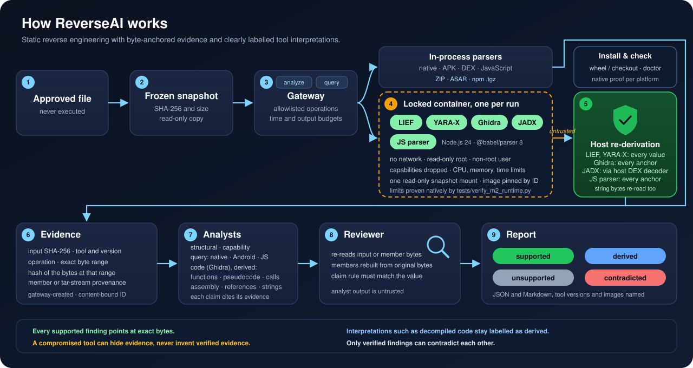

# ReverseAI

**A team of AI agents. Open reverse-engineering tools. Verifiable evidence.**

ReverseAI is an experimental project for coordinated, static reverse engineering
of untrusted files. Specialist agents will use narrowly defined analysis tools
in parallel, then a reviewer will check the evidence behind their conclusions.

**Status: M3a released: Ghidra joins LIEF and YARA-X.** Deterministic
analysts read file structure and string indicators in-process, and three pinned
open-source tools, LIEF, YARA-X and Ghidra, run in locked containers. Every value
LIEF and YARA-X report is re-derived by the host from the input bytes before it can
become evidence, and a reviewer re-checks each claim against those bytes. Ghidra's
functions, pseudocode and calls are its own reading: the host re-derives only their
anchors (the exact file bytes, inside an executable section), and the report shows
them as *derived*, never as verified.
Model-driven agents are not part of the current releases.

## How it works

<p align="center">
  
</p>

What this buys, and how each point is checked:

| Property | How it holds |
| --- | --- |
| A supported finding is backed by exact bytes | The reviewer recomputes the input hash, the byte range and its hash for every cited item, and the claim rule must yield exactly the claimed value. |
| A compromised tool can hide evidence but not invent verified evidence | The host re-derives every value LIEF and YARA-X report (headers, sections, signature matches) from its own copy of the bytes and refuses the whole reply on any mismatch; for Ghidra it re-derives every anchor, and Ghidra's interpretations can only ever be reported as derived. |
| Tools cannot reach the host or the network | One container per run: no network, read-only root, non-root user, every capability dropped, no new privileges, CPU, memory, process and time limits, a single read-only snapshot mount, image pinned by ID. `tests/verify_m2_runtime.py` proves these limits against the real engine. |
| Interpretations stay labelled | Ghidra's function lists, pseudocode and calls are *derived*: the host re-derives each anchor (the exact file bytes, inside an executable section), the reviewer re-checks them, and the report lists them apart; they never count as verified and never contradict a verified finding. |
| One claim cannot cancel a verified one | Only findings whose evidence all verifies can contradict each other. |
| Reports are reproducible | Same input and budget, same report; the report names each tool version and container image. |

## Roadmap

| Milestone | Scope | State |
| --- | --- | --- |
| M1 | Gateway, structural and capability analysts, evidence reviewer, reports | released |
| M2a | LIEF 1.0.0 in a container, host re-derivation of every worker value | released |
| M2b | YARA-X 1.21.0 in a container, reviewed literal ruleset, verified signature matches | released |
| M3a | Ghidra 12.1.4 headless on ELF and PE: functions, pseudocode, calls as derived evidence (contract/2) | released |
| M3b | Mach-O: host decoder and Ghidra on Mach-O; more Ghidra queries (imports, xrefs, strings by reference) | planned |
| M4 | JADX for Android packages | planned |
| M5 | JavaScript application analysis | planned |
| M6 | Professional release: packaging, setup, CI, multi-platform proofs | planned |
| M7 | Measured comparison with REA Safe Agent on a known-answer corpus | planned |
| M8 | Clean-room kit: evidence-cited functional specification, contamination check, auditable separation of analysis and implementation rooms, conformance tests | planned |

## Try it

Python 3.12 or later, no Python dependencies:

```sh
python3 -m reverseai analyze path/to/approved-file --out new-report-dir
python3 -B -m unittest discover -s tests -t . -v
```

With Docker and the locally built, pinned images (`tools/build_lief_image.py`,
`tools/build_yarax_image.py`, `tools/build_ghidra_image.py`), add `--with-lief`,
`--with-yarax` and `--with-ghidra`; the command
refuses cleanly when an image or Docker is missing. The native containment proof:

```sh
python3 -B tests/verify_m2_runtime.py --tool lief --profile small --offline --lock containers/lief/image.lock.json --receipt <new file>
```

The command reads one approved regular file without executing it and writes
`report.json` and `report.md`: supported findings with their byte evidence, and
rejected claims with the reviewer's reasons. Findings marked *inferred* are hints,
not proof of behaviour. The contract between components is in
[docs/contract.md](docs/contract.md).

Known limits, by design:

- ELF and PE headers and section tables are parsed; a Mach-O file is recognized
  by its magic bytes only until M3b. String indicators and signature rules are
  lexical hints, never proof of behaviour.
- A claim type without a rule in `reverseai/claims.py` is never supported. The
  Markdown report states supported findings in the reviewer's own words.
- In-process handlers have soft time budgets; contained workers have hard wall,
  memory and process limits. Containment is proven on Docker Desktop linux/arm64
  only; other platforms need their own proof.
- Reports contain bounded text taken from the sample. They are written with
  private permissions, and Markdown shows that text only inside code spans.

## Security foundation

The project intends to reuse selected safeguards from
[REA Safe Agent](https://github.com/dagoSte/rea-safe-agents): approved snapshots,
separately contained analysis and receiving clients, restricted tools, bounded
messages, fixed model destinations and repeatable verification.

The initial goal is direct use of open analysis tools without the REA runtime.
Any reused code must retain its license and attribution. REA Safe Agent's tests,
badges and past verification do not automatically apply to this new project.

The host controller, runtime and relevant kernel/hypervisor remain trusted.
Agent messages and tool results remain untrusted data. Agreement between agents
is not proof. Any future model-provider connection must disclose what data
leaves the machine.

## Development

The repository starts private. Project documentation is written in English.
The development team uses a separate local Squadra registry and dashboard;
these are not the product's analysis-agent runtime.

Claude coordinates development. Codex windows support implementation and
independent review in separately assigned scopes. Private inputs, logins,
transcripts, coordination state and local analysis outputs stay outside Git.

Developed by **Stefano D'Agostino**.
